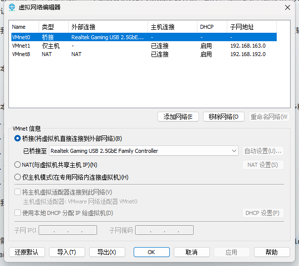

# VMware Workstation Pro 一键汉化

VMware Workstation Pro **26H1（2026）** 一键汉化工具——把官方已取消的**简体中文界面**补回来。

一个单文件 `vmware-zh-patcher.exe`，双击即可汉化**主程序 + 虚拟网络编辑器**，也支持一键恢复原版。



## 背景

VMware Workstation Pro 26H1（2026）起，官方**取消了简体中文界面**，26H1u1 仅提供 English / French / Japanese / Spanish 四种语言。中文系统用户看到的只有英文界面。

本项目把完整的汉化成果（源自 VMware 官方 17.6.4 中文资源，移植到 26H1 x64）打包成一个工具，一键完成汉化。

## 汉化覆盖

| 组件 | 文件 | 说明 |
|---|---|---|
| 语言消息目录 | `messages/zh_CN/vmware.vmsg` | 7379 条消息，93.4% 已汉化（含 85 条 26H1 新增 key 翻译） |
| 主界面资源 | `messages/zh_CN/vmui-zh_CN.dll` | 17.6.4 官方中文资源移植到 26H1 x64 |
| SDK 资源 | `messages/zh_CN/vmappsdk-zh_CN.dll` | 17.6.4 官方中文资源移植到 26H1 x64 |
| 托盘程序 | `vmware-tray.exe` | 26H1 x64 + 官方中文资源打入 slot 2052 |
| 虚拟网络编辑器 | `vmnetcfg.exe` | 213/221 条消息汉化（见 [`vmnetcfg/`](vmnetcfg/README.md)） |

> 剩余的纯英文条目，基本都是操作系统名（CentOS/macOS/FreeBSD/Solaris…）、键盘键名（Ctrl/Alt/Delete…）、硬件接口缩写（NAT/USB/IDE/SATA/SCSI/NVMe…）和错误码标识，本就应保留原文。

## 快速使用（推荐：一键 exe）

1. 下载 `vmware-zh-patcher.exe`（单文件，约 9.6 MB，已内嵌全部汉化产物）。
2. **关闭 VMware 相关进程**（尤其是 `vmware-tray.exe`、`vmware.exe`）。
3. **双击运行**：工具自动定位 VMware 安装目录，出现菜单：

   ```
   ==============================================
           请选择要执行的操作
   ==============================================
     [1] 全部汉化（主程序 + 虚拟网络编辑器）
     [2] 仅汉化主程序（不含 vmnetcfg）
     [3] 仅汉化虚拟网络编辑器（vmnetcfg）
     [4] 恢复原版（还原所有英文）
     [0] 退出
   ==============================================
   ```

4. 输入数字回车即可。选 `1` 一次完成全部汉化；不想动 vmnetcfg 就选 `2`。
5. 若自动定位失败（装在非默认路径），把 `vmware.exe` 拖到工具图标上，或命令行指定：
   ```
   vmware-zh-patcher.exe "D:\Program Files\VMware\VMware Workstation"
   ```
6. 完成后重新打开 VMware，即显示中文。

**恢复原版**：再次运行工具，选 `4` 恢复原版。

### 命令行参数（无人值守）

```
vmware-zh-patcher.exe --apply                 # 全部汉化
vmware-zh-patcher.exe --apply --no-vmnetcfg   # 仅汉化主程序
vmware-zh-patcher.exe --restore               # 直接恢复
vmware-zh-patcher.exe <安装目录> --apply
```

## 自动定位策略

工具按以下顺序定位 VMware 安装目录：

1. 注册表 `HKLM\SOFTWARE\VMware, Inc.\VMware Workstation` 的 `InstallPath`
2. 环境变量 `ProgramFiles` / `ProgramFiles(x86)` / `ProgramW6432`
3. 各盘符的 `Program Files\VMware\VMware Workstation` 等常见路径

## 原理

主程序汉化与虚拟网络编辑器（vmnetcfg）采用不同方式：

- **主程序**：文字通过 `messages/zh_CN/` 目录下的语言文件动态加载，只需部署正确的中文文件即可，**无需修改 vmware.exe 本体**。
- **虚拟网络编辑器（vmnetcfg.exe）**：文字硬编码在 exe 的 `.rdata` 段，需二进制等长替换 + 借用 padding（详见 [`vmnetcfg/README.md`](vmnetcfg/README.md)）。

本工具的做法：把 5 个汉化文件内嵌进 exe，运行时自动备份原文件到安装目录的 `vmware-zh_CN-backup/`，再复制汉化文件到对应位置。

## 目录结构

```
.
├── vmware-zh-patcher.exe     # 一键汉化工具（主程序 + vmnetcfg，核心）
├── vmware-zh.ico             # 工具图标
├── vmware_zh_patcher.py      # 工具源码
├── docs-screenshot-zh.png    # 汉化效果截图
└── vmnetcfg/                 # 虚拟网络编辑器汉化（子模块）
    ├── README.md             # 子模块说明与技术原理
    ├── auto_patch.py         # vmnetcfg 一键汉化脚本
    ├── ...                   # 脚本链与方案数据
    └── release/              # vmnetcfg 独立工具与成品
```

## 自行打包

```bash
# 目录结构需包含 assets/（5 个汉化文件）与 vmware_zh_patcher.py
pip install pyinstaller
pyinstaller --onefile --name vmware-zh-patcher --console \
  --icon "assets/vmware-zh.ico" \
  --add-data "assets;assets" vmware_zh_patcher.py
# 产物在 dist/vmware-zh-patcher.exe
```

`assets/` 需包含：

```
assets/
├── vmware.vmsg
├── vmui-zh_CN.dll
├── vmappsdk-zh_CN.dll
├── vmware-tray.exe
├── vmnetcfg_zh.exe
└── vmware-zh.ico
```

## 注意事项

- 汉化文件会破坏原数字签名（未签名属预期），部分杀软可能报警。
- VMware 升级后会覆盖汉化文件，需重新运行工具。
- 仅支持 VMware Workstation **26.x x64**；其他版本/架构可能不兼容。
- 本工具提供的汉化产物源自 VMware 官方 17.6.4 中文资源，版权归 Broadcom / VMware 所有，仅供学习研究。

## 免责声明

本项目仅用于技术学习与研究。VMware 及其相关文件版权归 Broadcom / VMware 所有。
